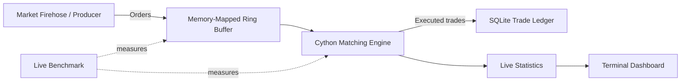

# ChronosMatch - Zero-Copy-Inspired High-Frequency Trading Engine

ChronosMatch is an experimental, Windows-based high-frequency trading (HFT) engine prototype. It demonstrates a multi-process market-order pipeline using a memory-mapped ring buffer, a Cython-based matching engine, SQLite trade persistence, and a live terminal dashboard.

> **Project scope:** This is an educational/prototype implementation, not a production trading system. The project uses memory-mapped IPC; the current serialization/deserialization path should not be described as strictly zero-copy.

## Key Features

- **Cython matching engine** - native extension built from `engine/matching_engine.pyx`.
- **Order matching** - price-time priority matching, including partial fills.
- **Memory-mapped IPC** - producer and consumer exchange orders through `chronosmatch_ring.dat`.
- **Separate processes** - market-order generation and order processing run independently.
- **SQLite trade ledger** - executed trades are persisted in `storage/chronosmatch.db`.
- **Live terminal dashboard** - displays engine statistics published through `dashboard/live_stats.json`.
- **Performance benchmarks** - scripts for IPC and end-to-end live benchmark runs.
- **Whale-order alert** - the consumer flags orders with quantity at or above the configured threshold.

## Architecture



### Main components

| Path | Responsibility |
|---|---|
| `main.py` | Launches the consumer, market firehose, and dashboard as separate processes |
| `simulator/` | Generates and publishes market orders |
| `ipc/` | Ring-buffer layout and memory-mapped IPC implementation |
| `engine/` | Cython matching engine and order consumer |
| `storage/` | SQLite trade ledger |
| `dashboard/` | Live-stat publishing and terminal dashboard |
| `benchmarks/` | IPC and live performance benchmark scripts |
| `test_matching.py` | Matching-engine tests |
| `test_ring_buffer.py` | Ring-buffer tests |
| `test_trade_ledger.py` | Trade-ledger tests |

## Technology Stack

- Python 3.10 (the compiled extension in the development environment is CPython 3.10 on Windows)
- Cython 3.3.0
- C / Cython native extension
- `mmap`-based shared file IPC
- SQLite
- `windows-curses` for the Windows terminal dashboard

## Requirements

- Windows 10/11
- Python 3.10
- Microsoft C++ Build Tools / Visual Studio C++ compiler to build the Cython extension
- PowerShell

The project’s `requirements.txt` currently pins:

```text
Cython==3.3.0
windows-curses==2.4.2
```

## Installation

Open PowerShell in the project directory:

```powershell
cd C:\Users\DELL\OneDrive\Desktop\chronosmatch
```

Create and activate a virtual environment:

```powershell
py -3.10 -m venv venv
.\venv\Scripts\Activate.ps1
```

Install Python dependencies:

```powershell
python -m pip install --upgrade pip
pip install -r requirements.txt
```

Build the Cython matching-engine extension in place:

```powershell
python setup.py build_ext --inplace
```

If the build reports that Microsoft Visual C++ 14.0 or later is required, install the **Desktop development with C++** workload from Visual Studio Build Tools, then reopen PowerShell and rerun the build command.

## Run ChronosMatch

The main launcher starts the consumer, market firehose, and terminal dashboard in separate Windows console windows.

```powershell
python main.py
```

By default, the launcher requests 20,000 orders at a target rate of 5,000 orders/second.

To specify the workload:

```powershell
python main.py --orders 1000000 --rate 5000
```

Arguments:

| Argument | Default | Description |
|---|---:|---|
| `--orders` | `20000` | Number of orders requested from the market firehose |
| `--rate` | `5000` | Target order-generation rate per second |

The launcher removes an existing ring-buffer file and live-statistics file before starting the processes. Press **Ctrl+C in the launcher window** to stop the launched processes.

## Run Tests

Run the test scripts from the project root:

```powershell
python test_ring_buffer.py
python test_matching.py
python test_trade_ledger.py
```

The development test runs reported:
- Ring-buffer test: passed
- Matching-engine tests: passed, including basic matching, partial fills, price priority, and time priority
- Trade-ledger test: 1,000 trades saved successfully

### Live Integration Test - 1,000 Orders

Command:

```powershell
python main.py --orders 1000 --rate 2000
```

Verified results from the development environment:

| Metric | Result |
|---|---:|
| Orders Processed | 1,000 |
| Trades Executed | 746 |
| SQLite Trades Saved | 746 |
| Throughput | 104 orders/sec |
| Average End-to-End Latency | 371,409.18 us |
| Average Cython Matching Latency | 10.54 us |
| Consumer Shutdown | Successful |
| Integration Status | PASSED |
**Validation:** All 746 executed trades were successfully persisted in SQLite. The producer completed successfully, the consumer drained the ring buffer, and the consumer shut down gracefully.


## Benchmarks

The following results are from the recorded development benchmark runs. They are measurements from the tested machine and configuration, not guaranteed performance on other systems.

### Synchronized live benchmark - 1,000,000 orders

Command:

```powershell
python -m benchmarks.live_benchmark --orders 1000000 --rate 5000
```

| Metric | Result |
|---|---:|
| Orders sent / received | 1,000,000 / 1,000,000 |
| Sequence errors | 0 |
| Trades | 500,000 |
| Producer / consumer rate | approximately 5,000 / 5,000 orders/sec |
| Remaining buffer depth | 0 |
| End-to-end average latency | 707.09 µs |
| End-to-end P50 latency | 420.90 µs |
| End-to-end P95 latency | 2,056.50 µs |
| End-to-end P99 latency | 3,839.40 µs |
| Cython matching average | 1.36 µs |
| Cython matching P50 | 0.90 µs |
| Cython matching P95 | 2.90 µs |
| Cython matching P99 | 5.50 µs |
| Benchmark status | PASSED |

**Latency note:** End-to-end latency includes time spent waiting in the shared ring buffer. Cython matching latency measures the matching-engine call separately. These figures are not interchangeable.

### IPC benchmark - 1,000,000 orders

Command:

```powershell
python -m benchmarks.ipc_benchmark
```

| Metric | Result |
|---|---:|
| Orders sent / received | 1,000,000 / 1,000,000 |
| Sequence errors | 0 |
| Producer time | 35.454 sec |
| Consumer time | 35.488 sec |
| Consumer rate | 28,178 orders/sec |
| Sequence validation | PASSED |

## Project Structure

```text
chronosmatch/
├── benchmarks/
│   ├── ipc_benchmark.py
│   └── live_benchmark.py
├── dashboard/
│   ├── live_stats.py
│   ├── run_dashboard.py
│   └── terminal_dashboard.py
├── engine/
│   ├── consumer.py
│   └── matching_engine.pyx
├── ipc/
│   ├── layout.py
│   └── ring_buffer.py
├── simulator/
│   ├── market_firehose.py
│   └── producer.py
├── storage/
│   └── trade_ledger.py
├── main.py
├── requirements.txt
├── setup.py
├── test_matching.py
├── test_ring_buffer.py
└── test_trade_ledger.py
```

Generated runtime files such as the ring-buffer data file, SQLite database, live-statistics JSON, and compiled build artifacts may appear when the project runs.

## Current Limitations

- This is a prototype for demonstrating systems and performance concepts; it is not suitable for live financial trading.
- The IPC mechanism is memory-mapped, but the current order packing/unpacking path means strict zero-copy behavior is not established.
- Benchmark latency and throughput depend on hardware, operating-system scheduling, process load, and benchmark configuration.
- The launcher uses Windows-specific console creation behavior.
- No exchange connectivity, authentication, risk controls, regulatory controls, or production deployment guarantees are provided.

## Possible Future Improvements

- Profile and optimize ring-buffer serialization and synchronization.
- Evaluate lock-free or lower-contention IPC designs.
- Improve order-book data structures and benchmark scaling under larger books.
- Add reproducible benchmark reports across multiple workloads.
- Add stronger recovery, validation, and operational safeguards.

## License

No license has been specified for this repository yet. Add a `LICENSE` file before presenting the project as open source.
